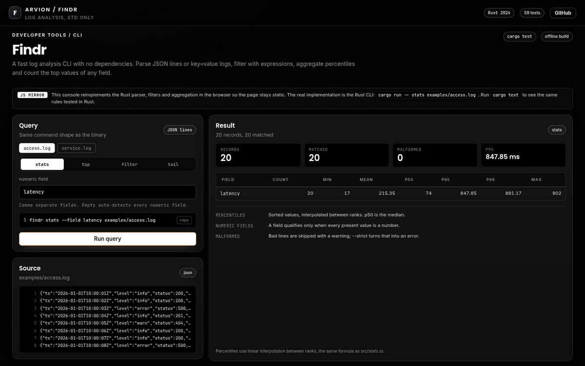
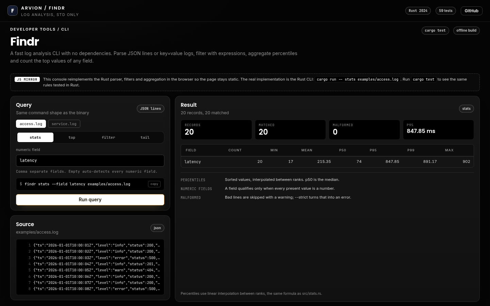
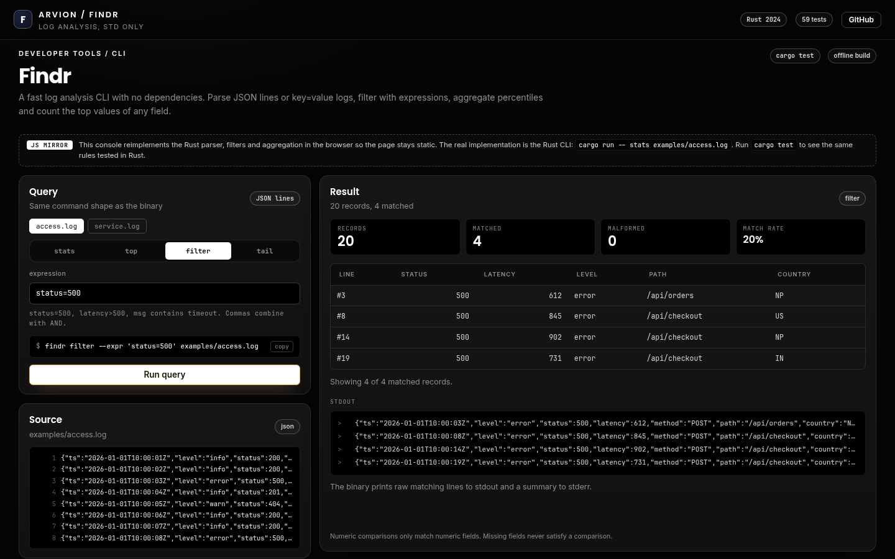

<div align="center">

</div>

<sub>Recorded from the live demo | <a href="docs/demo.mp4">MP4</a> | <a href="docs/screenshot.png">static frame</a></sub>

# Findr

Findr is a log analysis CLI written in Rust with no dependencies. It reads JSON
lines or key=value logs, filters with expressions, summarizes numeric fields
with percentiles, counts the top values of any field, and tails a file as it is
written. The binary builds with the standard toolchain and nothing else.

[**Open the live demo**](https://arvion-technology.github.io/labs/demos/findr/)

---

Most log queries start with grep and end with a one-off script. Findr is the
middle step: it understands both common log shapes, keeps numeric fields
numeric, and reports percentiles instead of a mean that a single slow request
can drag anywhere. The crate is small enough to read in an afternoon and structured for tests.

## What it does

- **Parses JSON lines and key=value logs**, detecting the format per line.
  Nested JSON becomes dotted keys, so `http.status` is a field like any other.
- **Filters** with `field=value`, `field!=value`, `field contains text`,
  `field>N`, `field>=N`, `field<N` and `field<=N`. Repeated expressions and
  comma separated clauses combine with AND.
- **Summarizes** any numeric field with count, min, max, sum, mean, p50, p95 and
  p99. Without `--field`, every field that is numeric in all records is used.
- **Counts top values** of a field with a deterministic order: count descending,
  then value ascending.
- **Tails** the last lines of a file, and with `--follow` polls for appended
  bytes.
- **Emits table or JSON**, and prints raw matching lines for `filter`, so the
  output can be piped or pasted into a report.
- **Benchmarks itself** with `findr bench`, which generates, parses and queries
  synthetic records without touching disk.

## Screenshots

| Stats with percentiles | Filter output |
| --- | --- |
|  |  |

The browser demo is a JavaScript mirror of the Rust parser, filters and
aggregation. It is there to make the behaviour visible on a static page; the Rust
implementation is the real product.

## Architecture

```text
examples/*.log
     |
     v
src/parser.rs   detect JSON lines / key=value / plain, flatten nested JSON
     |
     v
src/value.rs    typed values and records, JSON serialization
     |
     +--> src/filter.rs     expression parser and matching
     |
     +--> src/aggregate.rs  numeric field detection, top-N
     |         |
     |         v
     |    src/stats.rs      percentiles and summaries
     |
     +--> src/tail.rs       last lines, appended bytes, offsets
     |
     v
src/main.rs    argument parsing, input readers, tables and JSON output
```

The library has no knowledge of files or arguments. `src/main.rs` is the only
module that reads `std::env` or touches the filesystem, which is why the
integration tests can drive the compiled binary while unit tests call the
library directly.

## Quickstart

```bash
git clone https://github.com/arvion-technology/findr.git
cd findr
cargo test                 # 59 tests, no network, no crates
cargo run -- stats examples/access.log --field latency
cargo run -- top --by country -n 5 examples/access.log
cargo run -- filter --expr 'status=500' --expr 'latency>500' examples/access.log
cargo run -- tail --file examples/service.log --lines 5 --follow
```

Input can also come from stdin:

```bash
kubectl logs deploy/api --since=1h | findr stats --field duration_ms
cat examples/service.log | findr top --by level
```

Release builds are a single binary:

```bash
cargo build --release
./target/release/findr stats examples/access.log
```

`scripts/test.sh` is the one test entry point used by the project gate and CI:

```bash
bash scripts/test.sh        # cargo test --quiet
```

## How it works

**Format detection is per line, not per file.** A trimmed line starting with
`{` goes to the JSON parser. Otherwise the logfmt tokenizer looks for at least
one `key=value` pair; a timestamp prefix such as `2026-01-01T10:00:00Z` becomes
part of the `message` field while the pairs become fields. A line with no pairs
at all becomes a single `message` record. This means a mixed file still works,
and one malformed line does not change how the rest of the file is parsed.

**Only unambiguous values become numbers.** A logfmt value is converted to a
number only when the parsed float formats back to the original text, so `007`
stays a string and an order id keeps its leading zeros. Missing fields never
satisfy a comparison, including `!=`, which is treated as true only when the
field is absent. Equality compares numbers numerically and everything else by
its rendered string.

**Percentiles use linear interpolation between ranks.** The values are sorted,
the rank is `(n - 1) * p / 100`, and the result is interpolated between the two
neighboring values. For a small series this is more honest than nearest-rank
rounding: p50 of `[10, 20, 30, 40]` is 25, and p95 of four values is 38.5, not
40. The same function is tested at 0, 25, 50, 100 and on a single value.

**Tail reads complete lines only.** `tail` prints the final N lines, remembers
the file length, then polls for appended bytes. A trailing partial line is kept
for the next poll so a process that flushes half a line never produces half a
record. If the file shrinks, the reader assumes rotation and starts again from
zero.

## Tests

```bash
cargo test
```

59 tests: 36 unit tests in the library modules, 4 unit tests for argument
parsing, and 19 integration tests in `tests/cli.rs` that run the compiled binary
against `examples/access.log`, `examples/service.log` and
`examples/malformed.log`. The integration tests assert real output and exit
codes: percentile rows, JSON output, combined expressions, deterministic top-N,
tail counts, stdin input, strict mode, skipped malformed lines, missing files
and unknown flags. `cargo fmt --all -- --check` and
`cargo clippy --all-targets -- -D warnings` are clean as well.

The unit tests cover the JSON parser (escapes, unicode, malformed input), the
logfmt parser (quoted values, timestamp prefixes, leading zero ids), every filter
operator, interpolation, numeric field detection, top-N tie breaking and the tail
offset logic.

## Limitations

The browser console in `demo/` is a JavaScript mirror of the Rust logic, not the
Rust binary compiled to WebAssembly, so a change to the Rust implementation has
to be mirrored by hand and the page can drift; `cargo test` is the source of
truth. Two smaller constraints follow from keeping the crate dependency free:
`tail --follow` polls the file every 250 ms instead of using an OS file watcher,
and reading the last lines loads the file into memory, which is fine for typical
application logs but not for a multi-gigabyte archive.

## Project layout

```text
findr/
├── Cargo.toml
├── src/
│   ├── main.rs       # CLI: arguments, readers, table/JSON output
│   ├── lib.rs        # public library surface
│   ├── parser.rs     # JSON lines, key=value and plain line parsing
│   ├── json.rs       # minimal JSON reader
│   ├── value.rs      # typed values, records, JSON serialization
│   ├── filter.rs     # expression parsing and matching
│   ├── stats.rs      # percentiles and summaries
│   ├── aggregate.rs  # numeric fields, top-N, presence counts
│   └── tail.rs       # last lines and appended-byte polling
├── tests/cli.rs      # 19 integration tests against the compiled binary
├── examples/         # access.log, service.log, malformed.log
├── scripts/
│   ├── test.sh       # cargo test --quiet
│   ├── serve.mjs     # local static server for the demo
│   └── shot.mjs      # screenshot helper
└── demo/             # noir query console, JS mirror of the Rust logic
```

## Credits

Built by [Arvion Technologies](https://arviontech.net) in Kathmandu as part of
our open-source [Labs](https://github.com/arvion-technology/labs) series. MIT
licensed.
